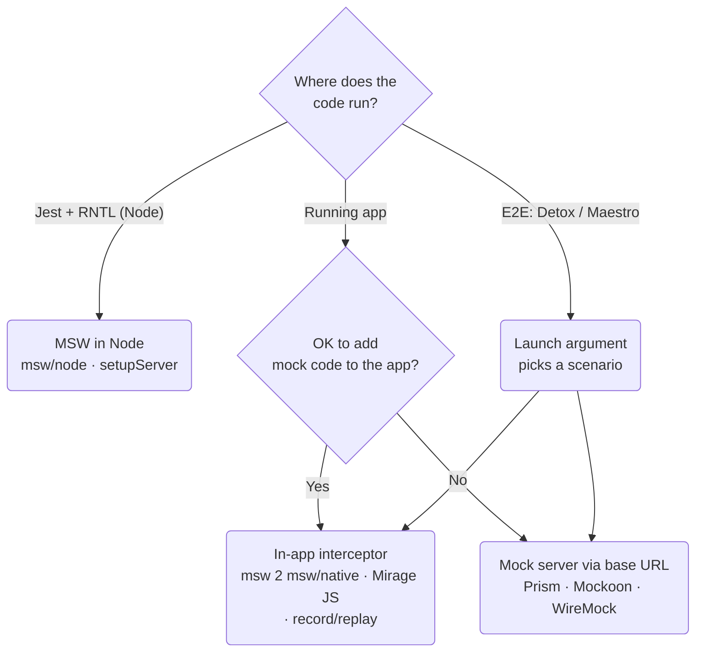
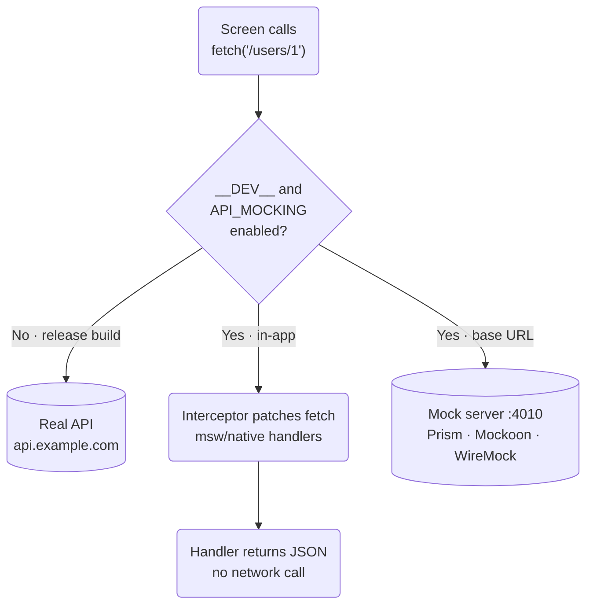
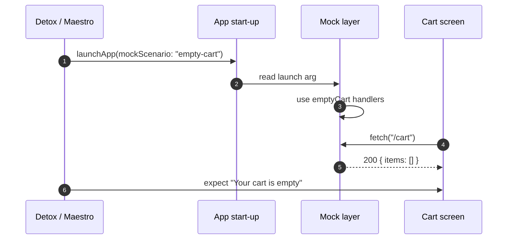

# devxtools.dev article readability spec (draft v1)

Owner: UX / Designer · 2026-10-18 · Status: **draft, not for publishing until Sebastian approves.** No pushes, PRs or comments were made.
Scope: the article template (`ArticleLayout.astro` and the guide, comparison, testing, observability and blog `[...slug]` pages) plus the hand-coded comparison pages. The pilot page is `/guides/mock-api-react-native/`.

Files in `/workspace/devxtools/readability/`:

| File | What it is |
|---|---|
| `readability-spec.md` | This spec |
| `article.css` | Ready-to-paste scoped CSS (`.dx-prose`, `.dx-table`, `.dx-diagram`, `.dx-callout`) |
| `rehype-dx-tables.mjs` | Build-time table wrapper (tested with unified + remark-gfm on the RN article: 3/3 tables wrapped) |
| `rehype-dx-mermaid.mjs` | Build-time swap from a mermaid fence to a light and dark SVG figure (tested with unified) |
| `render-diagrams.mjs` | Reference `npm run diagrams` script (Playwright + mermaid, local or CI) |
| `mermaid-theme.json` | Site mermaid theme for light and dark |
| `diagrams/*.mmd`, `diagrams/svg/*.svg` | Mermaid sources for the RN guide and their rendered light and dark SVGs |
| `mockup-after.html` | Static "after" mockup of a real RN guide excerpt (add `#dark` to the URL for dark mode) |
| `shots/` | `before-*` (live), `after-*` (mockup), `compare-*` (side by side), `diagram-*` |
| `live-measurements.json`, `live-audit-375.json`, `mockup-measurements.json` | Raw measurements |

---

## 1. Current state (measured on live, 2026-10-18)

Measured on the live RN guide with headless Chromium using computed styles (`measure.py`). This agrees with Editor's repo audit in `/workspace/devxtools/layout-audit/`.

| Property | 375px | 1280px | Note |
|---|---|---|---|
| Body font size / line-height | 15px / 22.5px (1.5) | 15px / 22.5px | `body { font-size: 15px }` in global.css |
| Measure | 335px (~45 chars) | **856px (~110–115 chars)** | `max-w-none` on the article |
| h1 / h2 / h3 | **15px, weight 400, margin 0** | same | Headings look exactly like body text |
| p margin | **0 / 0** | 0 / 0 | |
| ul / ol | **list-style none, padding 0** | same | No bullets or numbers at all |
| li spacing | 0 | 0 | |
| Code block | 13px/1.6, 12px padding, 8px radius, white bg + zinc-200 border, 16px margin | 14px/1.6, 16px padding, 24px margin | OK, but reads as a plain white box |
| Inline code | 0.8125em, zinc-100 bg, colour inherits | 0.875em | global sets red, then `.prose code { color: inherit !important }` overrides it |
| Blockquote (affiliation) | blue-500 left border, blue-50 bg | | **Off palette** (blue rather than indigo/zinc) |
| Table | `display:block; overflow:hidden`; content 700px wide in a 333px box | `display:table; overflow:hidden` | **Columns 3–5 are clipped and can't be reached** on mobile. The wrapper's scrollWidth equals its clientWidth, so it never scrolls |
| Table cells | `min-width:140px`, 8–10px padding, 1px zinc-200 row border, no zebra | | |
| Visuals | 0 images, 0 diagrams | | |

**Root causes:**
1. `class="prose prose-zinc dark:prose-invert"` is a **no-op**. `@tailwindcss/typography` isn't installed, so only Tailwind preflight applies: margins 0, headings inherit, `list-style: none`.
2. 15px body text with 1.5 leading, no measure cap.
3. Tables: `overflow:hidden` on `table` (global.css L245 and L262), `display:block` on mobile, `th,td{min-width:140px}`. The wrapper is added by a client-side script (Layout.astro, around L431) and has nothing to scroll because the table clips itself.
4. **Inter isn't loading for most visitors.** `@font-face` points at `https://rsms.me/inter/font-files/Inter-roman.var.woff2`, which now returns **404 (text/html)**. The current file is `.../InterVariable.woff2` (200, font/woff2). Visitors without Inter installed locally get `system-ui`. Fix: self-host `@fontsource-variable/inter` (or update the URL) and preload it.

### Other articles: same problems? (live audit at 375px, `live-audit-375.json`)

| Page | h2 | p margin | List markers | Tables clipped / total | Visuals |
|---|---|---|---|---|---|
| /guides/mock-api-react-native/ | 15px/400 | 0 | none | **1/3** | 0 |
| /guides/mock-api-calls-jest/ | 15px/400 | 0 | none | **1/1** | 0 |
| /guides/openapi-mock-server-prism/ | 15px/400 | 0 | none | **2/3** | 0 |
| /guides/pact-contract-testing-javascript/ | 15px/400 | 0 | none | **1/1** | 0 |
| /guides/faker-js-test-data-factories/ | 15px/400 | 0 | none | **2/2** | 0 |
| /testing/best-api-testing-tools/ | 15px/400 | 0 | none | **2/2** | 0 |
| /observability/datadog-alternatives/ | 15px/400 | 0 | none | **4/4** | 0 |
| /comparisons/k6-vs-jmeter/ | 15px/400 | 0 | none | **3/3** | 0 |
| /comparisons/opentelemetry-vs-prometheus/ | 15px/400 | 0 | none | **1/1** | 0 |
| /comparisons/pino-vs-winston/ | 15px/400 | 0 | none | **3/4** | 0 |
| /comparisons/pollyjs-alternatives/ | 15px/400 | 0 | none | **4/5** | 0 |
| /blog/why-i-built-mockifyer/ | 15px/400 | 24px | none | 0/1 | 0 |
| /comparisons/msw-vs-nock/ | 17.6px/400 | 0 | none | 0/1 (scrolls) | 0 |
| /guides/msw-vs-nock-vs-polly/ | 17.6px/400 | 0 | none | 0/1 (scrolls) | 0 |
| /guides/mock-api-playwright/ | 28px/600 | 20px | none | 0/0 | 0 |
| /comparisons/bruno-vs-postman/ | 28px/600 | 20px | none | **2/2** | 0 |
| /comparisons/playwright-vs-cypress/ | 28px/600 | 20px | none | **3/4** | 0 |
| /api-development/postman-alternatives/ | 28px/600 | 20px | none | **2/3** | 0 |

Takeaways:
- **All 12 markdown articles** have the dense-text problem. Only the blog post gets paragraph margins, and its headings are still flat.
- **31 tables on 14 of the 18 pages** are clipped on phones. The only exceptions are msw-vs-nock and msw-vs-nock-vs-polly (their tables scroll), why-i-built-mockifyer (a narrow table) and mock-api-playwright (no tables).
- The four hand-coded `.astro` pages (bruno-vs-postman, playwright-vs-cypress, postman-alternatives, mock-api-playwright) carry their own copy-pasted `.prose` CSS in unlayered `<style>` blocks. Their headings are spaced, but they **still have no list markers** and their tables are still clipped. Those unlayered styles beat any layered CSS, so remove them when `.dx-prose` lands, or the new styles won't apply on those pages.
- **No article has a single image or diagram.**

---

## 2. Sanity check of Editor's proposal

| Editor proposed | Verdict | Reasoning |
|---|---|---|
| Install `@tailwindcss/typography` | **Change: use scoped `.dx-prose` CSS instead** (the plugin is an acceptable fallback) | The plugin would fix the margins, but then we fight it in three places. (a) Its table, code and blockquote rules collide with the existing global `table`/`pre`/`:not(pre)>code` rules and the `!important` Shiki overrides. (b) `prose-invert` only covers part of our zinc/indigo dark mode, so we'd override most of it anyway. (c) The `<article class="prose">` also wraps the breadcrumbs, PollCard, StackPicker and newsletter, which all need `not-prose`. A 320-line scoped file whose values we control is simpler to reason about and to review. If CTO prefers the plugin, the token values below still apply, set via `--tw-prose-*` and element modifiers. |
| 16px body | **Keep on mobile, 17px from 1024px** | 16px is the minimum comfortable size on phones and avoids iOS input zoom quirks. On desktop at a ~600px measure, 17px Inter reads better and matches the larger h2. |
| line-height 1.75 | **Change to 1.7** (code 1.65, tables 1.5, h2 1.25, h3 1.35) | Inter has a tall x-height (about 0.55em), so it needs less leading than a serif. At 1.75 the line gap (about 12px at 16px) gets close to the paragraph gap, and paragraphs blur together. That's the opposite of what we want. 1.7 gives 27.2px at 16px and 28.9px at 17px, which is airy without the "double-spaced" look. I agree with your 1.7. |
| 72ch measure | **Change to 54ch** (equivalent to ~36rem) | This is the biggest correction. `ch` is the width of a "0", which in Inter is about 0.65em, while average English prose runs about 0.49em per character. 1ch is therefore about 1.3 characters, so **72ch ≈ 90–95 characters per line and 65ch ≈ 85**, both above the 60–75 target. I measured the mockup line by line (`mockup-measurements.json` and the calibration in the shell log): **54ch = 594px at 17px ≈ 64–70 characters per line** (median 64, p90 70, inline-code lines run shorter). Only text blocks get the measure. Tables, code and figures use the full 856px column. |
| h2 margin-top 2.5em | **Keep the intent, but use absolute values: 44px mobile / 56px desktop, and 12px to the content below** | "2.5em" on an h2 means 2.5 × 24–28px = 60–70px, which is too much on a 375px screen with 13 h2s. If Editor meant 2.5 × body size (40px), we're within a few pixels. Asymmetric spacing (large above, small below) is what makes a heading belong to its section. |
| Blocks 1.25em | **Keep for p and lists.** Code and tables get 1.5rem, figures 2rem, li + li 0.5em | Larger objects need more air than paragraphs. Lists use 0.5em between items so multi-line items stay distinct. |
| Tables `display:block; overflow-x:auto` | **Change to a wrapper div** (`role="region"`, `aria-label`, `tabindex="0"`) | `display:block` on `<table>` removes table semantics in some browser and screen-reader combinations (WebKit/VoiceOver especially), so row and column navigation can break. It also stops the table stretching to 100% width on desktop and makes sticky cells and rounded corners unreliable. The live site does this today, and combined with `overflow:hidden` it is exactly what clips the columns. A wrapper keeps `<table>` semantic, gives the scroll area a label and a tab stop (WCAG 2.1.1 and axe `scrollable-region-focusable`), and carries the border and 12px radius. I agree with your preference. |
| Client-side mermaid only on pages with a diagram (neutral/dark theme) | **Change to build-time SVG**, pre-rendered and committed | **JS weight:** mermaid 11.17's bundle measures 3.57 MB raw / **980 KB gzip**. The ESM build splits by diagram type, but the core and parser still load on every page with a diagram. Our build-time SVGs are **4–6 KB gzip each** (two copies, light and dark), with no JS. **CLS:** client rendering swaps a `<pre>` of source text for an SVG of unknown height after hydration, so you get a visible shift and a flash of raw mermaid unless you reserve a height per diagram. Build-time SVGs have a fixed viewBox, so CLS is zero. **Dark mode:** mermaid can't re-theme live. A toggle means re-rendering every diagram (flash, more JS) or keeping both versions. With build time, both versions are already in the HTML and CSS swaps them instantly with the `.dark` class. **Other:** the built-in neutral/dark themes ignore our indigo/zinc palette. SVG `<text>` is real text for RSS, reader mode, crawlers and LLMs. It works without JS. |

---

## 3. Typography tokens

All values are scoped to `.dx-prose`, the wrapper around `<slot />` only.

| Token / element | Mobile (<1024px) | Desktop (≥1024px) | Light | Dark |
|---|---|---|---|---|
| Body size / line-height | 16px / 1.7 (27.2px) | 17px / 1.7 (28.9px) | text zinc-800 `#27272a` (14.9:1) | zinc-300 `#d4d4d8` on zinc-950 (13.5:1) |
| Measure (p, ul, ol, h2–h4, blockquote, callout, figcaption) | 100% | **54ch ≈ 594px** (≈64–70 chars) | | |
| Wide blocks (table, pre, figure) | 100% | full column (856px) | | |
| Block flow (p, lists) | 1.25em | 1.25em | | |
| h2 | 24px / 1.25 / 700 / -0.015em | 28px | zinc-900 | zinc-50 |
| h2 margin top / bottom | 44px / 12px | 56px / 12px | | |
| h3 | 19px / 1.35 / 600 / -0.01em | 20px | zinc-900 | zinc-50 |
| h3 margin top / bottom | 32px / 12px | 32px / 12px | | |
| `scroll-margin-top` (anchors under the sticky header) | 5rem | 5rem | | |
| Lists | padding-left 1.5em, li padding-left 0.25em, li + li 0.5em, nested list 0.5em top, `ul ul` circle | same | markers zinc-500 (ol numbers 600 weight, tabular) | zinc-400 |
| Links | 500 weight, underline 1.5px, offset 3px | same | indigo-600 `#4f46e5` (6.3:1), underline indigo-200 | indigo-400 `#818cf8` (6.7:1), underline indigo-400/35% |
| Blockquote | 3px left border, padding-left 1.125em, muted text, not italic | same | border zinc-300, text zinc-600 | zinc-700 / zinc-400 |
| Callout `.dx-callout--note` | 14–15px/1.6, 1px border + 3px left, 10px radius, Lucide icon | same | indigo-50 bg, indigo-600 line/icon | indigo-500/10% bg, indigo-400 |
| Callout `.dx-callout--warn` | same | same | amber-50 bg, amber-600 line, amber-700 icon | amber/8% bg, amber-400 |
| Inline code | 0.86em, padding 0.1em 0.35em, 1px border, 5px radius, `overflow-wrap:anywhere` | same | zinc-100 bg, zinc-200 border, zinc-900 text (16:1) | zinc-800 bg, zinc-800 border, zinc-50 text |
| Code block | 13px / 1.65, padding 16px 18px, 12px radius, margin 1.5rem (pre + pre 1rem) | 14px | zinc-50 bg, zinc-200 border, Shiki github-light tokens | zinc-900 bg, zinc-800 border, Shiki github-dark |
| Figure | margin 2rem; frame 1px border, 12px radius | same | zinc-200 border | zinc-800 border |
| Figcaption | 14px / 1.5, margin-top 12px, measure-capped, "Figure N." in bold | same | zinc-600 | zinc-400 |
| hr | 1px, margin 3rem | same | zinc-200 | zinc-800 |
| Page h1 (outside `.dx-prose`) | 32px / 1.15 / 800 / -0.025em, max 22ch | 40px | | |

Also change: drop `body { font-size: 15px }` from the article scope (or entirely, to be confirmed with CTO). Move the affiliation box from blue to `.dx-callout--note` and the "Tested with" box to the plain blockquote style. Add `font-feature-settings: "cv11","ss01"` for Inter's single-storey a and open digits.

### Ready-to-paste CSS (`article.css`)

To wire it up in `ArticleLayout.astro`: remove `prose prose-zinc dark:prose-invert` from `<article>`, and wrap `<slot />` in `<div class="dx-prose">`. Put the affiliation and tested-with boxes in a small `.dx-prose` block above the slot, as in the mockup. Import `article.css` after the components layer in global.css. Delete global.css L230–L351 (all the `.prose table`/`table`/`thead`/`th,td`/`tbody` rules and the mobile `display:block` + sticky block), or scope them to `:not(.dx-table__scroll) > table` for non-article pages. Keep L353–L382 (the `.table-wrapper`/`.overflow-x-auto` fades) until the hand-coded pages move to `.dx-table`. Delete the client-side table script in Layout.astro (around L431–L496) because the rehype plugin replaces it. Keep only the small overflow-state script (section 4).

```css
/* ==========================================================================
   devxtools.dev — article body typography ("dx-prose")
   Paste into src/styles/article.css and import it from global.css
   (after the existing @layer components block), then put class="dx-prose"
   on a <div> that wraps ONLY <slot /> in ArticleLayout.astro.
   Requires: @custom-variant dark (&:where(.dark, .dark *)) — already in global.css.
   No @tailwindcss/typography needed.
   ========================================================================== */
@layer components {
  .dx-prose {
    /* ---- tokens: light ---- */
    --dx-text: #27272a;            /* zinc-800  body          14.9:1 on white */
    --dx-heading: #18181b;         /* zinc-900                                */
    --dx-muted: #52525b;           /* zinc-600  captions etc.  7.7:1          */
    --dx-subtle: #71717a;          /* zinc-500  markers, meta  4.8:1          */
    --dx-border: #e4e4e7;          /* zinc-200                                */
    --dx-border-strong: #d4d4d8;   /* zinc-300                                */
    --dx-surface: #ffffff;
    --dx-surface-2: #fafafa;       /* zinc-50   code, zebra                   */
    --dx-surface-3: #f4f4f5;       /* zinc-100  thead, inline code            */
    --dx-accent: #4f46e5;          /* indigo-600 links 6.3:1                  */
    --dx-accent-soft: #eef2ff;     /* indigo-50                               */
    --dx-accent-line: #c7d2fe;     /* indigo-200                              */
    --dx-shadow: rgb(9 9 11 / 0.10);

    /* ---- type scale (mobile first) ---- */
    --dx-fs: 1rem;                 /* 16px */
    --dx-lh: 1.7;
    --dx-measure: 54ch;            /* Inter 1ch≈0.65em → ≈68–72 chars/line; tables/code/figures use full width */
    --dx-flow: 1.25em;             /* default gap between blocks */
    --dx-h2: 1.5rem;               /* 24px */
    --dx-h3: 1.1875rem;            /* 19px */
    --dx-code-fs: 0.8125rem;       /* 13px */

    font-size: var(--dx-fs);
    line-height: var(--dx-lh);
    color: var(--dx-text);
    font-feature-settings: "cv11", "ss01";   /* Inter: single-storey a, open digits */
    min-width: 0;
  }
  @media (min-width: 1024px) {
    .dx-prose {
      --dx-fs: 1.0625rem;          /* 17px */
      --dx-h2: 1.75rem;            /* 28px */
      --dx-h3: 1.25rem;            /* 20px */
      --dx-code-fs: 0.875rem;      /* 14px */
    }
  }
  .dark .dx-prose {
    --dx-text: #d4d4d8;            /* zinc-300 on zinc-950  13.5:1 */
    --dx-heading: #fafafa;
    --dx-muted: #a1a1aa;           /* zinc-400  7.8:1 */
    --dx-subtle: #a1a1aa;
    --dx-border: #27272a;          /* zinc-800 */
    --dx-border-strong: #3f3f46;   /* zinc-700 */
    --dx-surface: #09090b;         /* zinc-950 (page bg) */
    --dx-surface-2: #18181b;       /* zinc-900 */
    --dx-surface-3: #27272a;       /* zinc-800 */
    --dx-accent: #818cf8;          /* indigo-400  6.7:1 on zinc-950 */
    --dx-accent-soft: rgb(99 102 241 / 0.10);
    --dx-accent-line: rgb(129 140 248 / 0.35);
    --dx-shadow: rgb(0 0 0 / 0.45);
  }

  /* ---- vertical rhythm: one rule, then exceptions ---- */
  .dx-prose > * { margin-block: 0; }
  .dx-prose > * + * { margin-top: var(--dx-flow); }

  /* text-y blocks keep the measure; wide blocks span the column */
  .dx-prose > :is(p, ul, ol, h2, h3, h4, blockquote, dl) { max-width: var(--dx-measure); }

  /* ---- headings ---- */
  .dx-prose :is(h2, h3, h4) {
    color: var(--dx-heading);
    text-wrap: balance;
    scroll-margin-top: 5rem;       /* sticky header */
  }
  .dx-prose h2 {
    font-size: var(--dx-h2);
    line-height: 1.25;
    font-weight: 700;
    letter-spacing: -0.015em;
  }
  .dx-prose > * + h2 { margin-top: 2.75rem; }          /* 44px */
  @media (min-width: 1024px) { .dx-prose > * + h2 { margin-top: 3.5rem; } } /* 56px */
  .dx-prose h3 {
    font-size: var(--dx-h3);
    line-height: 1.35;
    font-weight: 600;
    letter-spacing: -0.01em;
  }
  .dx-prose > * + h3 { margin-top: 2rem; }
  .dx-prose h4 { font-size: 1em; font-weight: 600; }
  .dx-prose > * + h4 { margin-top: 1.5rem; }
  .dx-prose > :is(h2, h3, h4) + * { margin-top: 0.75rem; }  /* heading binds to its content */
  .dx-prose h2 code, .dx-prose h3 code { font-size: 0.85em; }

  /* ---- paragraphs, emphasis, links ---- */
  .dx-prose p { text-wrap: pretty; }
  .dx-prose strong { font-weight: 600; color: var(--dx-heading); }
  .dx-prose a {
    color: var(--dx-accent);
    font-weight: 500;
    text-decoration: underline;
    text-decoration-color: var(--dx-accent-line);
    text-decoration-thickness: 1.5px;
    text-underline-offset: 3px;
  }
  .dx-prose a:hover { text-decoration-color: currentColor; }
  .dx-prose a:focus-visible { outline: 2px solid var(--dx-accent); outline-offset: 2px; border-radius: 2px; }

  /* ---- lists ---- */
  .dx-prose :is(ul, ol) { padding-left: 1.5em; }
  .dx-prose ul { list-style: disc; }
  .dx-prose ol { list-style: decimal; }
  .dx-prose li { padding-left: 0.25em; }
  .dx-prose li + li { margin-top: 0.5em; }
  .dx-prose li::marker { color: var(--dx-subtle); }
  .dx-prose ol > li::marker { font-weight: 600; font-variant-numeric: tabular-nums; }
  .dx-prose li > :is(ul, ol) { margin-top: 0.5em; }
  .dx-prose ul ul { list-style: circle; }
  .dx-prose li > p { margin: 0; }
  .dx-prose li > p + :is(p, pre) { margin-top: 0.5em; }
  .dx-prose li > pre { margin-block: 0.75em; }
  /* list item that starts with a bold lead-in ("Jest tests. …") */
  .dx-prose li > strong:first-child { color: var(--dx-heading); }

  /* ---- blockquote + callouts ---- */
  .dx-prose blockquote {
    border-left: 3px solid var(--dx-border-strong);
    padding: 0.125em 0 0.125em 1.125em;
    color: var(--dx-muted);
  }
  .dx-prose blockquote > * + * { margin-top: 0.75em; }
  .dx-callout {
    --c-bg: var(--dx-surface-2);
    --c-line: var(--dx-border-strong);
    --c-icon: var(--dx-subtle);
    display: grid;
    grid-template-columns: 1.25rem 1fr;
    gap: 0.75rem;
    padding: 0.875rem 1rem;
    border: 1px solid var(--dx-border);
    border-left: 3px solid var(--c-line);
    border-radius: 0.625rem;
    background: var(--c-bg);
    font-size: 0.9375em;
    line-height: 1.6;
    max-width: var(--dx-measure);
  }
  .dx-callout > svg { width: 1.25rem; height: 1.25rem; margin-top: 0.15em; color: var(--c-icon); }
  .dx-callout > div > * + * { margin-top: 0.5em; }
  .dx-callout--note { --c-bg: var(--dx-accent-soft); --c-line: var(--dx-accent); --c-icon: var(--dx-accent); border-color: var(--dx-accent-line); border-left-color: var(--dx-accent); }
  .dx-callout--warn { --c-bg: #fffbeb; --c-line: #d97706; --c-icon: #b45309; border-color: #fde68a; border-left-color: #d97706; }
  .dark .dx-callout--warn { --c-bg: rgb(245 158 11 / 0.08); --c-icon: #fbbf24; border-color: rgb(245 158 11 / 0.30); border-left-color: #f59e0b; }

  /* ---- inline code ---- */
  .dx-prose :not(pre) > code {
    font-family: ui-monospace, SFMono-Regular, Menlo, Monaco, Consolas, "Liberation Mono", monospace;
    font-size: 0.86em;
    padding: 0.1em 0.35em;
    border: 1px solid var(--dx-border);
    border-radius: 0.3rem;
    background: var(--dx-surface-3);
    color: var(--dx-heading) !important;   /* beats the global `.prose code { color: inherit !important }` */
    overflow-wrap: anywhere;               /* long package names wrap instead of overflowing */
    word-break: normal;
    -webkit-box-decoration-break: clone;
    box-decoration-break: clone;
  }

  /* ---- code blocks (Shiki dual theme keeps token colours) ---- */
  .dx-prose pre,
  .dx-prose pre.astro-code {
    font-size: var(--dx-code-fs);
    line-height: 1.65;
    padding: 1rem 1.125rem !important;
    border: 1px solid var(--dx-border);
    border-radius: 0.75rem;
    background-color: var(--dx-surface-2) !important;
    overflow-x: auto;
    tab-size: 2;
    -webkit-text-size-adjust: 100%;
  }
  .dark .dx-prose pre.astro-code { background-color: var(--dx-surface-2) !important; }
  .dark .dx-prose .astro-code span { background-color: transparent !important; }
  .dx-prose pre:focus-visible { outline: 2px solid var(--dx-accent); outline-offset: 2px; }
  .dx-prose > pre { margin-top: 1.5rem; }
  .dx-prose > pre + pre { margin-top: 1rem; }
  .dx-prose > pre + * { margin-top: 1.5rem; }

  /* ---- figures (images, screenshots, diagrams) ---- */
  .dx-prose figure { margin-top: 2rem; }
  .dx-prose figure + * { margin-top: 2rem; }
  .dx-figure__frame {
    border: 1px solid var(--dx-border);
    border-radius: 0.75rem;
    background: var(--dx-surface);
    overflow: hidden;
  }
  .dx-figure__frame > img { display: block; width: 100%; height: auto; }
  .dx-prose figcaption {
    margin-top: 0.75rem;
    font-size: 0.875rem;
    line-height: 1.5;
    color: var(--dx-muted);
    max-width: var(--dx-measure);
  }
  .dx-prose figcaption strong { color: var(--dx-text); }

  /* ---- hr ---- */
  .dx-prose hr { border: 0; border-top: 1px solid var(--dx-border); margin-block: 3rem; }

  /* ===================== TABLES ===================== */
  .dx-table {
    position: relative;
    margin-top: 1.75rem;
    border: 1px solid var(--dx-border);
    border-radius: 0.75rem;
    background: var(--dx-surface);
    overflow: hidden;                      /* clips corners only; scrolling happens inside */
  }
  .dx-prose > .dx-table + * { margin-top: 1.5rem; }
  .dx-table__scroll {
    overflow-x: auto;
    overscroll-behavior-x: contain;
    scrollbar-width: thin;
    scrollbar-color: var(--dx-border-strong) transparent;
  }
  .dx-table:has(.dx-table__scroll:focus-visible) { outline: 2px solid var(--dx-accent); outline-offset: 2px; }
  .dx-table__scroll:focus { outline: none; }
  .dx-table table {
    width: 100%;
    min-width: calc(var(--cols, 3) * 8.5rem);   /* 2 cols fit a phone; 4–5 cols scroll */
    border-collapse: separate;                  /* needed for sticky cells + borders */
    border-spacing: 0;
    font-size: 0.9375em;                        /* 15px / 16px */
    line-height: 1.5;
    border: 0; border-radius: 0; background: transparent; overflow: visible; margin: 0; /* undo global table rules */
  }
  .dx-table :is(th, td) {
    padding: 0.75rem 1rem;
    text-align: left;
    vertical-align: top;
    min-width: 0;                               /* undo global th,td{min-width:140px} */
    border-bottom: 1px solid var(--dx-border);
    background: inherit;
  }
  .dx-table thead th {
    background: var(--dx-surface-3);
    color: var(--dx-heading);
    font-size: 0.8125rem;
    font-weight: 600;
    letter-spacing: 0.01em;
    white-space: nowrap;
    border-bottom: 1px solid var(--dx-border-strong);
  }
  .dx-table tbody tr { background: var(--dx-surface); }
  .dx-table tbody tr:nth-child(even) { background: var(--dx-surface-2); }  /* zebra */
  .dx-table tbody tr:last-child > * { border-bottom: 0; }
  .dx-table tbody th { font-weight: 600; color: var(--dx-heading); }
  .dx-table tbody tr:hover { background: var(--dx-accent-soft); }
  .dx-table td code, .dx-table th code { font-size: 0.82em; padding: 0.05em 0.3em; }

  /* sticky first column, only when the table actually scrolls (set by script) */
  .dx-table[data-overflow] :is(thead th, tbody th):first-child {
    position: sticky; left: 0; z-index: 1;
    min-width: 8.5rem; max-width: 11rem;
    border-right: 1px solid var(--dx-border);
  }
  .dx-table[data-overflow] thead th:first-child { background: var(--dx-surface-3); }
  .dx-table[data-scrolled] :is(thead th, tbody th):first-child { box-shadow: 8px 0 10px -8px var(--dx-shadow); }

  /* right-edge fade: visible while more columns are hidden */
  .dx-table::after {
    content: ""; position: absolute; top: 0; right: 0; bottom: 0; width: 2.5rem;
    pointer-events: none; opacity: 0; transition: opacity .15s;
    background: linear-gradient(to right, transparent, var(--dx-surface) 85%);
  }
  .dx-table[data-overflow="end"]::after,
  .dx-table[data-overflow="both"]::after { opacity: 1; }
  .dx-table__hint {
    display: none;
    margin-top: 0.5rem;
    font-size: 0.8125rem;
    color: var(--dx-subtle);
  }
  .dx-table[data-overflow] + .dx-table__hint { display: flex; align-items: center; gap: .375rem; }
  @media (prefers-reduced-motion: reduce) { .dx-table::after { transition: none; } }

  /* ===================== MERMAID (build-time SVG) ===================== */
  .dx-diagram .dx-figure__frame {
    padding: 1.25rem;
    background: var(--dx-surface-2);
    overflow-x: auto;                      /* wide diagrams scroll on phones */
    overscroll-behavior-x: contain;
  }
  .dx-diagram .dx-figure__frame:focus-visible { outline: 2px solid var(--dx-accent); outline-offset: 2px; }
  .dx-diagram svg {
    display: block;
    margin-inline: auto;
    width: var(--w, 100%);                 /* --w = natural SVG width, set by the build step */
    max-width: 100%;                       /* desktop: shrink to fit the column */
    height: auto;
  }
  @media (max-width: 767px) {
    .dx-diagram svg {                      /* phones: don't shrink text below ~11px; scroll instead */
      max-width: none;
      width: calc(var(--w, 640px) * 0.8);
    }
    .dx-diagram svg[data-narrow] { width: 100%; max-width: var(--w); }  /* small diagrams just fit */
  }
  /* each diagram is emitted twice; show the one that matches the theme */
  .dx-diagram .mmd-dark { display: none; }
  .dark .dx-diagram .mmd-light { display: none; }
  .dark .dx-diagram .mmd-dark { display: block; }
}

@layer components {
  .dx-prose > .dx-table + .dx-table__hint { margin-top: 0.5rem; }
}
```

---

## 4. Table overflow pattern

**Markup** (generated at build time, so no client wrapping and no layout shift):

```html
<div class="dx-table" style="--cols:5">                  <!-- border + 12px radius + edge fade -->
  <div class="dx-table__scroll" role="region" tabindex="0"
       aria-label="Table: TL;DR">                         <!-- the only scroller -->
    <table>
      <thead><tr><th scope="col">Approach</th>…</tr></thead>
      <tbody><tr><th scope="row">MSW …</th><td>…</td>…</tr></tbody>
    </table>
  </div>
</div>
<p class="dx-table__hint" aria-hidden="true">Swipe the table to see all 5 columns →</p>
```

**Behaviour:**
- **Width:** `table { width:100%; min-width: calc(var(--cols) * 8.5rem) }`. Two-column tables (the RN host-URL table) fit a 375px phone with no scroll. Tables with four or five columns scroll. On desktop, tables fill the 856px column and only scroll if they genuinely don't fit.
- **Edge hint:** a 40px fade on the right edge (`.dx-table::after`, gradient to the surface colour) shows while columns are still hidden. Once the reader scrolls, the sticky first column casts an 8px shadow. A one-line hint ("Swipe the table to see all 5 columns →", zinc-500, 13px) appears only when the table overflows.
- **Sticky first column:** only when the table overflows (`[data-overflow]`), 8.5–11rem wide, with an opaque background (`background: inherit` from the row, so zebra stripes stay correct) and a 1px right border. This keeps "MSW / Mirage / Mock server" visible while reading the Yes/No columns.
- **Row separation** (your earlier table fix): 1px zinc-200 (dark: zinc-800) bottom border on every cell, **plus zebra** stripes on even rows (zinc-50, dark zinc-900). The header is zinc-100 (dark zinc-800) with a stronger zinc-300/zinc-700 bottom rule and 13px semibold text. Hovered rows get indigo-50 (dark indigo/10%). Cell padding is 12px 16px and text is 15/16px at line-height 1.5.
- **Keyboard / AT:** the scroller is a labelled region with `tabindex=0`. The focus ring (2px indigo, 2px offset) sits on the outer `.dx-table` via `:has(:focus-visible)`, so the rounded clip doesn't cut it off. Arrow keys scroll. The label is derived from the nearest preceding h2–h4, as the current client script does. The first body cell becomes `th scope=row` and header cells get `scope=col`.
- **Overflow-state script** (~20 lines, replaces the current DOMContentLoaded wrapper in Layout.astro). It sets `data-overflow="end|both|start"` and `data-scrolled` from scroll and a ResizeObserver, and removes `tabindex` when the table doesn't overflow, so there are no pointless tab stops on desktop. It also does the same for diagram frames. The code is at the bottom of `mockup-after.html`. Without JS, the table still scrolls and stays focusable; you just don't get the sticky column or the fade.

**Applying it automatically:** `rehype-dx-tables.mjs` (full code below) goes in `markdown.rehypePlugins` in `astro.config.mjs`, and MDX inherits it. It wraps every table, counts columns into `--cols`, converts the first cell to a row header and adds the label and hint. It needs `unist-util-visit` as an explicit dependency. Hand-coded `.astro` tables can use the same markup directly, or a small `<DxTable label=…>` component.

```js
// rehype-dx-tables.mjs — wraps every markdown table at build time.
// astro.config.mjs:  markdown: { rehypePlugins: [rehypeDxTables] }   (MDX inherits it)
// Output:
// <div class="dx-table" style="--cols:5">
//   <div class="dx-table__scroll" role="region" tabindex="0" aria-label="Table: TL;DR">
//     <table>… thead th[scope=col] … tbody first cell → th[scope=row] …</table>
//   </div>
// </div>
// <p class="dx-table__hint" aria-hidden="true">Swipe the table to see all 5 columns →</p>
import { visit, SKIP } from 'unist-util-visit';

const text = (n) => n.type === 'text' ? n.value : (n.children || []).map(text).join('');
const el = (tagName, properties, children) => ({ type: 'element', tagName, properties, children });

export default function rehypeDxTables() {
  return (tree) => {
    let lastHeading = '';
    let count = 0;
    visit(tree, 'element', (node, index, parent) => {
      if (/^h[2-4]$/.test(node.tagName)) { lastHeading = text(node).trim(); return; }
      if (node.tagName !== 'table' || !parent || index == null) return;
      if (parent.properties?.className?.includes?.('dx-table__scroll')) return;
      count++;

      const thead = node.children.find((c) => c.tagName === 'thead');
      const tbody = node.children.find((c) => c.tagName === 'tbody');
      const headRow = thead?.children.find((c) => c.tagName === 'tr');
      const cols = headRow ? headRow.children.filter((c) => c.type === 'element').length : 3;
      headRow?.children.forEach((c) => { if (c.tagName === 'th') c.properties = { ...c.properties, scope: 'col' }; });
      tbody?.children.forEach((tr) => {
        const first = tr.children?.find((c) => c.type === 'element');
        if (first?.tagName === 'td') { first.tagName = 'th'; first.properties = { ...first.properties, scope: 'row' }; }
      });

      const label = `Table: ${lastHeading || `table ${count}`}`;
      const scroll = el('div', { className: ['dx-table__scroll'], role: 'region', tabIndex: 0, ariaLabel: label }, [node]);
      const box = el('div', { className: ['dx-table'], style: `--cols:${cols}` }, [scroll]);
      const hint = el('p', { className: ['dx-table__hint'], ariaHidden: 'true' }, [
        { type: 'text', value: `Swipe the table to see all ${cols} columns →` },
      ]);
      parent.children.splice(index, 1, box, hint);
      return [SKIP, index + 2];
    });
  };
}
```

---

## 5. Mermaid diagrams

**Approach: render at build time, commit the SVGs, ship no JS.**
- Authors write a normal fenced block with a caption and alt text in the fence meta:
  ````mermaid caption="Figure 1. …" alt="Flowchart. …"`
- `rehype-dx-mermaid.mjs` (with `syntaxHighlight.excludeLangs: ['mermaid']` so Shiki leaves the fence alone) hashes the source and inlines `src/diagrams/rendered/<hash>-light.svg` and `-dark.svg` into a `<figure class="dx-diagram">`. It **fails the build** if a diagram hasn't been rendered or has no `alt`.
- `npm run diagrams` (`render-diagrams.mjs`) renders with Playwright and mermaid, locally or in GitHub Actions. This follows the same pattern as the existing `og` / `check:og` scripts.
- **Why not `rehype-mermaid` or `astro-mermaid` rendering inside `astro build`?** Both need a headless browser at build time, but `package.json`'s postinstall **skips the Playwright install when `CF_PAGES` is set**, so a Cloudflare Pages build would fail. rehype-mermaid's dark variant also relies on `prefers-color-scheme` (`<picture>`/media), which doesn't follow the site's manual `.dark` toggle. Pre-rendering avoids both problems. If CTO moves the build to GitHub Actions, rehype-mermaid with `strategy: 'inline-svg'` and two passes would also work.
- **Inline SVG, not ``:** SVG loaded as an image can't use the page's Inter, and labels were measured in Inter, so text would overflow. Inline SVG also keeps the text selectable. Each diagram costs about 8–12 KB gzip for both copies, and the hidden copy is `display:none`, so it isn't read twice.
- **Accessibility:** `role="img"` plus a full `aria-label` from `alt` (mermaid's own `graphics-document` role has weak screen-reader support). The frame is a labelled group that is focusable only when it scrolls.
- **Phone-first authoring rule:** prefer `flowchart TD`. Use LR only for flows of three nodes or fewer. Keep labels to about 3–5 words per line (with `<br/>`), and fewer than 8 nodes per diagram. On phones, diagrams render at 80% of natural size (text ≥11px) and scroll horizontally inside the frame. On desktop they scale down to fit the column.

**Theme** (`mermaid-theme.json`, `theme: 'base'`): Inter, 14px, `htmlLabels:false` (pure SVG text), 10px rounded nodes via `themeCSS`, zinc nodes and lines. Primary nodes use `:::accent`, and the render script appends a per-mode `classDef accent` (light: indigo-50 fill, indigo-600 stroke, indigo-950 text; dark: indigo-950 fill, indigo-400 stroke, indigo-50 text). Sequence actors are indigo-tinted.

```json
{
  "common": {
    "theme": "base",
    "fontFamily": "Inter, ui-sans-serif, system-ui, sans-serif",
    "flowchart": { "htmlLabels": false, "curve": "basis", "padding": 14, "nodeSpacing": 36, "rankSpacing": 44, "useMaxWidth": false },
    "sequence": { "useMaxWidth": false, "mirrorActors": false, "actorMargin": 40, "boxMargin": 8, "messageFontWeight": 400 },
    "themeCSS": ".node rect, .node polygon, .node path { stroke-width: 1.25px; } .node rect { rx: 10px; ry: 10px; } rect.actor { rx: 10px; ry: 10px; stroke-width: 1.25px; } .edgeLabel, .edgeLabel rect { rx: 6px; ry: 6px; } .messageText { font-size: 13px !important; } .edgeLabel text, .edgeLabel span { font-size: 12.5px; }"
  },
  "light": {
    "themeVariables": {
      "fontSize": "14px",
      "background": "transparent",
      "primaryColor": "#fafafa",
      "primaryBorderColor": "#d4d4d8",
      "primaryTextColor": "#18181b",
      "secondaryColor": "#f4f4f5",
      "tertiaryColor": "#ffffff",
      "mainBkg": "#fafafa",
      "nodeBorder": "#d4d4d8",
      "lineColor": "#71717a",
      "textColor": "#3f3f46",
      "edgeLabelBackground": "#ffffff",
      "clusterBkg": "#fafafa",
      "clusterBorder": "#e4e4e7",
      "actorBkg": "#eef2ff",
      "actorBorder": "#4f46e5",
      "actorTextColor": "#18181b",
      "actorLineColor": "#d4d4d8",
      "signalColor": "#52525b",
      "signalTextColor": "#18181b",
      "sequenceNumberColor": "#ffffff",
      "noteBkgColor": "#f4f4f5",
      "noteBorderColor": "#d4d4d8",
      "noteTextColor": "#3f3f46"
    },
    "accentClassDef": "classDef accent fill:#eef2ff,stroke:#4f46e5,stroke-width:1.5px,color:#1e1b4b"
  },
  "dark": {
    "themeVariables": {
      "darkMode": true,
      "fontSize": "14px",
      "background": "transparent",
      "primaryColor": "#18181b",
      "primaryBorderColor": "#3f3f46",
      "primaryTextColor": "#fafafa",
      "secondaryColor": "#27272a",
      "tertiaryColor": "#09090b",
      "mainBkg": "#18181b",
      "nodeBorder": "#3f3f46",
      "lineColor": "#a1a1aa",
      "textColor": "#d4d4d8",
      "edgeLabelBackground": "#09090b",
      "clusterBkg": "#18181b",
      "clusterBorder": "#27272a",
      "actorBkg": "#1e1b4b",
      "actorBorder": "#818cf8",
      "actorTextColor": "#fafafa",
      "actorLineColor": "#3f3f46",
      "signalColor": "#a1a1aa",
      "signalTextColor": "#fafafa",
      "sequenceNumberColor": "#09090b",
      "noteBkgColor": "#27272a",
      "noteBorderColor": "#3f3f46",
      "noteTextColor": "#d4d4d8"
    },
    "accentClassDef": "classDef accent fill:#1e1b4b,stroke:#818cf8,stroke-width:1.5px,color:#eef2ff"
  }
}
```

**Figure wrapper** (output of the plugin, styled by `.dx-diagram` in article.css):

```html
<figure class="dx-diagram">
  <div class="dx-figure__frame" role="group" tabindex="0" aria-label="Diagram, scrolls horizontally">
    <svg class="mmd-light" role="img" aria-label="Flowchart. …" style="--w:697px" viewBox="…">…</svg>
    <svg class="mmd-dark"  role="img" aria-label="Flowchart. …" style="--w:697px" viewBox="…">…</svg>
  </div>
  <figcaption><strong>Figure 1.</strong> Pick the mock by where the code runs, not by tool popularity.</figcaption>
</figure>
```

```js
// rehype-dx-mermaid.mjs — swaps ```mermaid fences for pre-rendered light + dark SVGs.
// No mermaid JS ships to the browser. SVGs are rendered by `npm run diagrams`
// (scripts/render-diagrams.mjs, Playwright + mermaid, run locally/CI) and committed to
// src/diagrams/rendered/, because Cloudflare Pages builds skip the Playwright install.
//
// astro.config.mjs:
//   markdown: {
//     syntaxHighlight: { type: 'shiki', excludeLangs: ['mermaid'] },
//     rehypePlugins: [rehypeDxMermaid, rehypeDxTables],
//   }
// Authoring (.md):
//   ```mermaid caption="Figure 1. Pick the mock by where the code runs." alt="Flowchart. …"
//   flowchart TD
//     …
//   ```
import { visit } from 'unist-util-visit';
import { fromHtml } from 'hast-util-from-html';
import { createHash } from 'node:crypto';
import { readFileSync, existsSync } from 'node:fs';
import { resolve } from 'node:path';

const DIR = resolve('src/diagrams/rendered');
export const diagramHash = (src) => createHash('sha1').update(src.trim()).digest('hex').slice(0, 12);
const text = (n) => n.type === 'text' ? n.value : (n.children || []).map(text).join('');
const meta = (s = '', key) => (s.match(new RegExp(`${key}="([^"]*)"`)) || [])[1];

export default function rehypeDxMermaid() {
  return (tree, file) => {
    visit(tree, 'element', (node, index, parent) => {
      if (node.tagName !== 'pre' || !parent) return;
      const code = node.children.find((c) => c.tagName === 'code');
      const cls = code?.properties?.className || [];
      if (!cls.includes('language-mermaid')) return;

      const src = text(code);
      const m = code.data?.meta || '';
      const alt = meta(m, 'alt');
      const caption = meta(m, 'caption');
      if (!alt) file.fail(`mermaid diagram without alt="…" in ${file.path}`, node);

      const hash = diagramHash(src);
      const svgs = ['light', 'dark'].map((mode) => {
        const p = `${DIR}/${hash}-${mode}.svg`;
        if (!existsSync(p)) file.fail(`Diagram ${hash} not rendered. Run: npm run diagrams`, node);
        const root = fromHtml(readFileSync(p, 'utf8'), { fragment: true, space: 'svg' });
        const svg = root.children.find((c) => c.tagName === 'svg');
        const w = Math.round(Number(String(svg.properties.viewBox).split(/\s+/)[2]));
        delete svg.properties.width; delete svg.properties.height; delete svg.properties.style;
        for (const k of Object.keys(svg.properties)) if (/roledescription/i.test(k)) delete svg.properties[k];
        Object.assign(svg.properties, {
          className: [`mmd-${mode}`], style: `--w:${w}px`, role: 'img', ariaLabel: alt,
          focusable: 'false', dataNarrow: w <= 420 ? '' : undefined,
        });
        return svg;
      });

      const figure = {
        type: 'element', tagName: 'figure', properties: { className: ['dx-diagram'] },
        children: [
          { type: 'element', tagName: 'div',
            properties: { className: ['dx-figure__frame'], role: 'group', tabIndex: 0, ariaLabel: 'Diagram, scrolls horizontally' },
            children: svgs },
          ...(caption ? [{ type: 'element', tagName: 'figcaption', properties: {}, children: [{ type: 'text', value: caption }] }] : []),
        ],
      };
      parent.children.splice(index, 1, figure);
    });
  };
}
```

---

## 6. Visuals for the RN guide (4 visuals; the host-URL table stays a table)

Based on Editor's three drafts. I kept two, judged the third better as a table, and added one screenshot and one sequence diagram.

| # | Section (actual heading) | Type | What it shows | Caption | Alt text |
|---|---|---|---|---|---|
| 1 | **"Three places you need mocks"**, after the numbered list, before "Most confusion comes from…" | Mermaid flowchart TD (Editor's "where the code runs" decision tree) | Where the code runs → Jest (msw/node) / running app → "OK to add mock code?" → in-app interceptor or mock server / E2E → launch arg picks a scenario for either | **Figure 1.** Pick the mock by where the code runs, not by tool popularity. | Flowchart. Where does the code run? Jest and RNTL in Node: use MSW's msw/node. The running app: if adding mock code to the app is OK, use an in-app interceptor (msw 2 msw/native, Mirage JS or record/replay); if not, point the base URL at a mock server (Prism, Mockoon, WireMock). E2E with Detox or Maestro: a launch argument picks a scenario for either option. |
| 2 | **"Mocking in the running app"**, right under the h2, before "MSW in the app: the MSW 3 situation" | Mermaid flowchart TD (Editor's request flow) | fetch → guard (`__DEV__` + API_MOCKING) → release: real API / in-app: interceptor → handler returns JSON / base URL: mock server :4010 | **Figure 2.** One guard, two ways to mock: patch `fetch` inside the app, or send it to a mock server. Release builds always hit the real API. | Flowchart. The screen calls fetch. A guard checks __DEV__ and the API_MOCKING flag. If off (release build) the request goes to the real API. If on with in-app mocking, an interceptor patches fetch and a handler returns JSON without a network call. If on with a base URL, the request goes to a mock server on port 4010. |
| 3 | **"Toggling mocks with `__DEV__`, env vars or a dev menu"**, after the list | Screenshot pair from **devxtools-rn-sample** (task list with the "Mocked · Server error 500" badge + Lab panel with the scenario chip and request log) | What "a dev-menu or in-app switch lets QA change scenarios without rebuilding" looks like in practice | **Figure 3.** An in-app scenario switch in the devxtools RN sample: choosing "Server error 500" changes what `fetch` returns without a rebuild, and the request log shows which handler answered. | Two screens from the devxtools React Native sample app. Left: the task list shows 'No tasks yet' with a 'Mocked · Server error 500' badge. Right: the Lab panel with MSW selected, the 'Server error 500' scenario chip highlighted, and the request log listing GET /tasks returning 500. |
| 4 | **"Mocking during E2E with Detox and Maestro"**, after the Maestro snippet, before "In the app, read them with…" | Mermaid sequence diagram (scenario switching) | Test runner → launch arg → mock layer applies the scenario handlers → screen fetches → empty response → assertion | **Figure 4.** The test picks the scenario at launch; the app never knows it's under test. | Sequence diagram. 1: Detox or Maestro launches the app with mockScenario "empty-cart". 2: At start-up the app reads the launch argument. 3: The mock layer switches to the empty-cart handlers. 4: The cart screen fetches /cart. 5: The mock layer returns 200 with an empty items list. 6: The test asserts "Your cart is empty". |
| – | **"Pointing the app at a mock server"**, host URL per simulator/emulator/device | **Keep as a table** (Editor's third draft, judged) | | | |

**Why the host URLs stay a table:** it's lookup data (4 rows × 2 columns). Readers scan for their row and **copy the URL**, and SVG text isn't convenient to copy. A diagram would add arrows without adding meaning. With the new pattern this table fits a 375px phone **without scrolling** (`--cols:2`, verified in `after-375-*-full.png`), with `code` formatting, row headers and zebra rows. If Sebastian still wants a visual here later, a small "your laptop ↔ simulator / emulator / device" network sketch would be the option, but I'd rather not.

**Cut on purpose:** Mirage, Record and replay, and Debugging get no visuals; code is clearer there. Four visuals across 13 sections is about one every three sections, which isn't cluttered.

**Screenshot note for #3:** the mockup uses the existing web-export captures (`/workspace/pr5v2-shots/05-tasks-500.png` + `06-log-500.png`, composited at `assets/rn-sample-500-scenario.png`). For publishing, recapture on the iOS simulator once Sebastian's device smoke test is done, at 2× and exported as WebP (~60–90 KB), with `width`/`height` attributes and `loading="lazy"`.

### Mermaid sources

Figure 1: `diagrams/where-code-runs.mmd`


Figure 2: `diagrams/request-flow.mmd` (Editor's draft was app → guard → interceptor or mock server; I added the release-build branch so the safety guard is visible)


Figure 4: `diagrams/scenario-switch.mmd`


In the article each fence gets the meta, for example ````mermaid caption="Figure 1. Pick the mock by where the code runs, not by tool popularity." alt="Flowchart. …"`. Disclosure check: the diagrams never name Mockifyer ("record/replay" is used instead), so no asterisk is needed inside an image.

---

## 7. Before / after mockup

`mockup-after.html` renders a real excerpt: the disclosure (as a note callout), Tested with, intro, TL;DR + the 5-column table, "Three places you need mocks" + Figure 1, Jest code block + list, "Mocking in the running app" + Figure 2, MSW 3 + a warning callout, Toggling + Figure 3, and the host-URL table. It uses the exact `article.css` and the rendered SVGs.

| | 375px | 1280px |
|---|---|---|
| Live (before), light | `shots/before-375-light{,-body,-table}.png` | `shots/before-1280-light{,-body,-table}.png` |
| Live (before), dark | `shots/before-375-dark{…}.png` | `shots/before-1280-dark{…}.png` |
| Mockup (after), light | `shots/after-375-light{,-body,-table,-table-scrolled,-diagram,-full}.png` | `shots/after-1280-light{,-body,-table,-diagram,-full}.png` |
| Mockup (after), dark | `shots/after-375-dark{…}.png` | `shots/after-1280-dark{…}.png` |
| Side by side | `shots/compare-375-{light,dark}-{body,table}.png` | `shots/compare-1280-{light,dark}-{body,table}.png` |
| Diagrams alone | `shots/diagram-{where-code-runs,request-flow,scenario-switch}-{light,dark}.png` | |

Measured in the mockup: body 16px/27.2px → 17px/28.9px; h2 24 → 28px; text column 594px at 1280px (~64–70 characters per line). The TL;DR table scrolls inside its frame at 375px (680px of content in 333px, `data-overflow="end"`, sticky first column) and needs no scroll at 1280px. No page-level horizontal overflow at either width.

---

## 8. Implementation checklist for CTO (after Sebastian approves)

1. Add `src/styles/article.css`; wrap `<slot/>` in `.dx-prose`; drop the `prose*` classes; restyle the affiliation and tested-with boxes.
2. Remove the global table rules (global.css L230–L351) and the `.prose code` `!important` override, or scope them to non-article pages.
3. Add `rehype-dx-tables` (and `rehype-dx-mermaid` with `excludeLangs: ['mermaid']`) in astro.config. Delete the Layout.astro client table wrapper and add the 20-line overflow-state script.
4. Self-host Inter (`@fontsource-variable/inter`) and fix the 404 `@font-face` URL.
5. Remove the copy-pasted `.prose` `<style>` blocks from bruno-vs-postman, playwright-vs-cypress, postman-alternatives and mock-api-playwright, and put their tables in `.dx-table` markup.
6. `npm run diagrams` plus the four RN figures. Recapture Figure 3 on the simulator.
7. Tests: extend `viewport-overflow.spec.ts`. At 375px, assert that every `table` is either within its scroller's width or its scroller has `scrollWidth > clientWidth` (so no clipped tables), that h2 font size is ≥24px, that `ul` has `list-style-type: disc`, and that axe `scrollable-region-focusable` passes.
